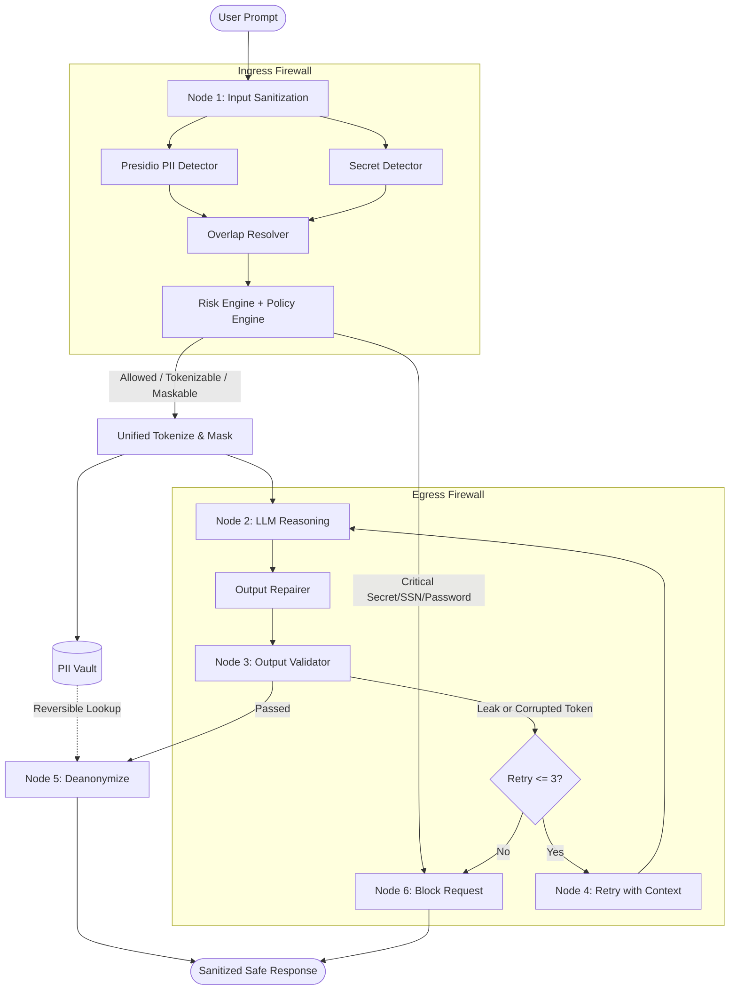

# Agentic PII Sanitization Firewall 🛡️

A high-performance, defense-in-depth security gateway that protects Large Language Model (LLM) agents from ingesting sensitive Personally Identifiable Information (PII) and leaking confidential credentials.

---

## 🏛️ Architecture Overview

The firewall employs a **dual-boundary architecture** orchestrated with **LangGraph**:



---

## 🚀 Key Features

- **Dual-Boundary Defense:** Ingress sanitization stops data exposure to third-party or local LLMs; egress validation stops regurgitation of sensitive tokens or hallucinations.
- **Unified Right-to-Left Tokenization & Masking:** Safely processes both reversible tokens (e.g. `[EMAIL_ADDRESS_1]`) and irreversible redactions (e.g. `************3456`) in a single pass without character offset corruption.
- **Collision-Resistant Vault:** Single-pass regex substitution prevents sub-token collisions (`[PERSON_10]` vs `[PERSON_1]`).
- **Expanded Secret Detection:** Out-of-the-box regex matching for raw and labeled credentials:
  - OpenAI API keys (`sk-...`)
  - AWS Access Key IDs (`AKIA...`)
  - GitHub Tokens (`ghp_...`, `gho_...`)
  - Slack Tokens (`xoxb-...`, `xoxp-...`)
  - Database URIs (`postgresql://`, `mysql://`, `mongodb://`, `redis://`, etc.)
  - Private Keys (`RSA`, `EC`, `OPENSSH`, `DSA`)
  - JSON Web Tokens (JWT)
- **Self-Healing Output Repair:** Heals slightly malformed placeholders (e.g. `<PERSON_1>` or unbracketed `PERSON_1`) before failing over to costly LLM retries.
- **Context-Aware Retry Loop:** Passes prior model outputs and security critiques back to the LLM during retries for reliable self-correction.
- **Boundary-Aware Egress Scanning:** Prevents false-positive denials on common first names that double as auxiliary English verbs (e.g., *"Will"*, *"May"*).

---

## 📦 Installation & Setup

### Prerequisites
- Python 3.11+
- Recommended: [uv](https://github.com/astral-sh/uv) (for ultra-fast environment & package management)

### 1. Clone and Install Dependencies
```powershell
# Using uv (recommended)
uv sync

# Or using standard pip
pip install -e .
```

### 2. Download spaCy Language Model
Presidio Analyzer utilizes spaCy for Named Entity Recognition (NER):
```powershell
uv run python -m spacy download en_core_web_sm
```

---

## ⚙️ Configuration

The firewall can be configured via environment variables:

| Variable | Default | Description |
| :--- | :--- | :--- |
| `FIREWALL_LLM_BASE_URL` | `http://127.0.0.1:8080/v1` | OpenAI-compatible endpoint (vLLM, Ollama, llama.cpp, LocalAI) |
| `FIREWALL_LLM_API_KEY` | `not-needed` | API key for LLM provider (or OpenAI key) |
| `FIREWALL_LLM_MODEL` | `Qwen3-1.7B-Q8_0.gguf` | Target LLM model name |
| `FIREWALL_LLM_TIMEOUT` | `60.0` | Request timeout in seconds |

---

## 💻 Running the Firewall

### Interactive CLI Mode
Run the interactive terminal prompt:
```powershell
uv run python run.py
```

### Quick Verification Run
```powershell
uv run python main.py
```

---

## 🧪 Testing

The test suite validates input masking, tokenization, vault restoration, output firewall validation, and secret detection:

```powershell
uv run pytest -v
```
